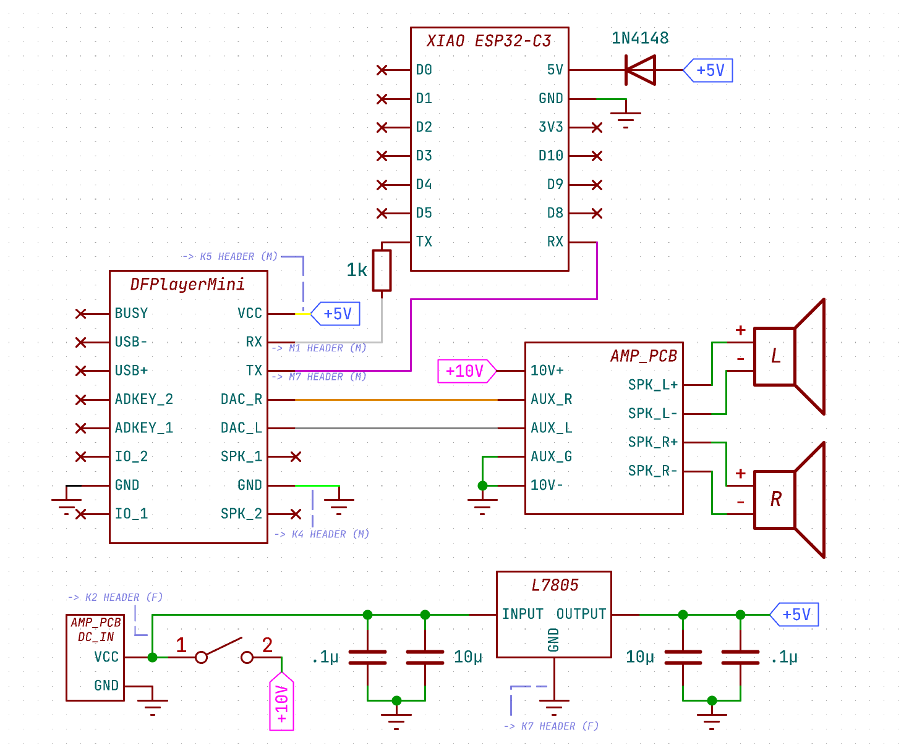

# WhiteNoiseMachine

Severance-themed device used to play white noise. Part of Delaney's 2025 Christmas gifts.

A XIAO ESP32-C3 drives a DFPlayer Mini clone that loops one of 14 sounds from an
SD card. It's controlled from a phone through a small home-screen app, the
"Acoustic Wellness Unit". The box serves that app itself, over HTTPS, so it opens
instantly and works the same on any phone on the home Wi-Fi.

- [How it works](#how-it-works)
- [Hardware](#hardware)
- [First-time setup](#first-time-setup)
- [Using the app](#using-the-app)
- [Updating the firmware](#updating-the-firmware)
- [Renewing the certificate](#renewing-the-certificate)
- [Troubleshooting](#troubleshooting)
- [For developers](#for-developers)
- [Ideas](#ideas)

---

## How it works

```
 phone (home-screen app)
    │  HTTPS + secure WebSocket   https://whitenoise.local
    ▼
 XIAO ESP32-C3 ──UART 9600──▶ DFPlayer Mini clone ──line out──▶ amplifier ──▶ speakers
                                  (SD card: 14 sounds)
```

- **The app is built into the firmware.** The page, its icons and its offline
  copy all come from the box, so the app and the firmware can't drift apart,
  and one update changes both.
- **One WebSocket per phone.** A phone sends commands, and the box pushes its
  state back to every connected phone, so two phones always mirror each other.
- **HTTPS with your own certificate.** Phones only let a web app work offline
  (run its "service worker") on a secure page. No public authority will vouch
  for a box on a home network, so `tools/make_certs.py` makes a tiny private
  one. Each phone trusts it once.
- **Nothing blocks.** The box answers the phone straight away, and the sound
  changes happen in the background: fades, confirming each command with the
  module, and resending lost ones.

---

## Hardware

### Schematic


### Wiring Notes
#### DC Input PCB *(AMP_PCB DC_IN)*
> - `VCC` -> Switch, L7805 *`INPUT`* (via solid wire to *`K2`* female header)
> - `GND` -> L7805 *`GND`* (via solid wire to *`K7`* female header)

#### Amplifier PCB *(AMP_PCB)*
> - `10V+` -> Switch
> - `10V-` -> L7805 *`GND`* (via solid wire to *`K3`* female header)
> - `AUX_G` -> *`10V-`* solder point (via solid wire)
> - `AUX_R` -> DFPlayerMini *`DAC_R`* (via stripped **ORANGE** female-to-female jumper)
> - `AUX_L` -> DFPlayerMini *`DAC_L`* (via stripped **GREY** female-to-female jumper)
> - `SPK_L+` -> Left speaker positive terminal (direct soldered)
> - `SPK_L-` -> Left speaker negative terminal (direct soldered)
> - `SPK_R+` -> Right speaker positive terminal (direct soldered)
> - `SPK_R-` -> Right speaker negative terminal (direct soldered)

#### DFPlayerMini
> - `VCC` -> L7805 *`OUTPUT`* (via **YELLOW** female-to-female jumper to *`K5`* header)
> - `RX` -> ESP32 *`TX`* (via **WHITE** female-to-female jumper to *`M1`* header)
> - `TX` -> ESP32 *`RX`* (via **PURPLE** female-to-female jumper to *`M7`* header)
> - `GND` -> L7805 *`GND`* (via **GREEN** female-to-female jumper to *`K4`* header)

#### XIAO ESP32-C3
> - `5V` -> L7805 *`OUTPUT`* (direct soldered, through diode)
> - `GND` -> L7805 *`GND`* (direct soldered)
> - `RX` -> DFPlayerMini *`TX`* (via **PURPLE** female-to-female jumper)
> - `TX` -> DFPlayerMini *`RX`* (via **WHITE** female-to-female jumper)

#### L7805
> - `INPUT` -> DC Input PCB *`VCC`* (via solid wire to *`K2`* female header)
> - `OUTPUT` -> ESP32 *`5V`* (direct soldered, through diode), DFPlayerMini *`VCC`* (via **YELLOW** female-to-female jumper to *`K5`* header)
> - `GND` -> Star-point, common to all other grounds

### Pins

| XIAO pin | Use |
|---|---|
| `D7` (RX) | from the module's `TX` |
| `D6` (TX) | to the module's `RX` |
| `D1`–`D5`, `D10` | free |
| `D0`, `D8`, `D9` | free, but **avoid**: they're the C3's boot-strapping pins, and a signal held on them at power-on can stop it booting |

### SD card

The module numbers files **in the order they were copied onto the card**, not
by name. Track N in the app is the Nth file copied:

| # | Sound | # | Sound | # | Sound |
|---|---|---|---|---|---|
| 1 | Airplane Cabin | 6 | Waterfall | 11 | Shower |
| 2 | Celestial | 7 | Water Fountain | 12 | Hairdryer |
| 3 | Thunderstorm | 8 | Ocean Waves | 13 | Vacuum |
| 4 | Rain | 9 | Fan | 14 | Soup |
| 5 | Rainforest | 10 | Campfire | | |

To set up a card, format it FAT32 (32 GB or smaller) and copy the files one at
a time, in order. On a Mac, name them so they sort in order (`01 Airplane
Cabin.mp3` … `14 Soup.mp3`), then:

```bash
mkdir -p /Volumes/WNM/mp3
for f in ~/WhiteNoise/*.mp3; do cp "$f" /Volumes/WNM/mp3/; done   # one at a time, in name order
dot_clean -m /Volumes/WNM   # removes macOS's hidden ._ files, which the module would count as tracks
```

To change the sounds, edit `SOUNDS` in `web/index.html` and `TRACK_COUNT` in
`lib/Player/Player.h` (up to 32 tracks).

---

## First-time setup

Do these once, in order. Steps 1–5 are on your computer and router; step 6 is
on each phone.

### 1. Tools
- [PlatformIO](https://platformio.org/): the VS Code extension, or `pip install platformio` for the `pio` command.
- Python 3 with `cryptography`: `python3 -m pip install cryptography`.

### 2. Secrets
```bash
cp include/config/secrets_example.h include/config/secrets.h
```
Fill in `wifi_ssid`, `wifi_password` and `ota_key`.

- The Wi-Fi network must be **2.4 GHz**; the C3 has no 5 GHz radio. A combined 2.4/5 GHz network name is fine.
- `ota_key` is any phrase you choose: up to 64 letters, digits and dashes. Every wireless update must carry it. Leave it empty to turn wireless updates off.

`secrets.h` is gitignored. Never put credentials anywhere else.

### 3. Reserve the box's address
On your router, give the box a fixed IP (a DHCP reservation). After the first
boot it appears in the router's client list as `whitenoise`. This gives you a
second way in when `whitenoise.local` doesn't resolve, which is common on
Android.

### 4. Make the certificates
```bash
python3 tools/make_certs.py --ip 192.168.1.50      # your reserved IP
```
The first run creates **your home authority**: `certs/ca.key` and `certs/ca.crt`,
valid for 10 years. Every run also issues **the box's certificate**:
`certs/server.key` and `certs/server.crt`, for `whitenoise.local` and that IP,
valid for 825 days. The server certificate is built into the firmware. The
script prints when it expires, so add a calendar reminder.

> **Back up `certs/`** to somewhere private, like a password manager or an
> encrypted drive. It's gitignored, so this computer has the only copy. Keep
> `ca.key` secret: a phone that trusts your authority would trust *any*
> certificate signed with that key, for any website. If it's lost or leaked,
> see [Renewing the certificate](#renewing-the-certificate).

### 5. Flash over USB
```bash
pio run -t upload        # builds and uploads the "usb" environment
pio device monitor       # optional: watch it boot (Ctrl+C to quit)
```
The first flash must be over USB, and so must any flash that changes the
partition table. After that, [update wirelessly](#updating-the-firmware).

A healthy boot looks like this:
```
Boot: last reset: power on
OTA: running firmware 1a2b3c4d
Settings: restored track 4, volume 12, playing
Net: connecting to <your network>
Web: UI build 3f9c2a71
Web: HTTPS server listening on port 443
Web: port 80 redirects to HTTPS
Boot: done (audio module warming up)
Net: online as 192.168.1.50 (-55 dBm)
Net: mDNS up at https://whitenoise.local
Audio: warm-up done (the module said hello)
Audio: starting track 4, fading up to 12
Audio: the module confirms commands -- pacing by its replies
```

### 6. Set up each phone
First get `certs/ca.crt` onto the phone: AirDrop it, or email it to yourself.
Only `ca.crt`, **never** `ca.key`.

**iPhone**

1. Open `ca.crt`. iOS says *Profile Downloaded*.
2. **Settings → General → VPN & Device Management** → *White Noise Machine home CA* → **Install**.
3. **Settings → General → About → Certificate Trust Settings** → turn on *White Noise Machine home CA*.
   This step is easy to miss, and without it Safari still warns.
4. In Safari, open `https://whitenoise.local`, then **Share → Add to Home Screen**.

**Android** (menu names vary by maker)

1. **Settings → Security & privacy → More security settings → Encryption & credentials → Install a certificate → CA certificate**, and pick `ca.crt`.
2. In Chrome, open `https://whitenoise.local` (or `https://<reserved IP>`), then **⋮ → Add to Home screen**.

If an older home-screen icon exists from before HTTPS, delete it first; it
points at the old `http://` address.

**Your computer (optional).** `pio run -e ota` and `curl --cacert` don't need
this. To open the app in a desktop browser without a warning: on a Mac,
double-click `ca.crt`, then in Keychain Access set it to *Always Trust*.

---

## Using the app

| To… | Do this |
|---|---|
| Play a sound | Tap it. The current sound fades down and the new one rises in. |
| Pause / resume | The big button under the sound name. |
| Stop | **Stop**, at the bottom. It fades out first. |
| Change the volume | Drag the slider. The number is the box's *actual* level. While it fades you'll see `14 → 20`. |
| Pin a sound | Hold its row for half a second. Pins go in a grid at the top, are stored on the box, and show on both phones. Hold again to unpin. |
| Night mode | **Night mode**, at the bottom: dim amber, no blue. It's remembered per phone. |
| Diagnostics | Hold the title, *Acoustic Wellness Unit*, for about a second. |

The lamp at the top right shows the link to the box. **Linked** means
connected. **Linking** and **Not linked** mean it's trying. With the box off,
the app still opens (from the phone's own copy), says *The box is off or
off-network*, and connects by itself once the box is back.

### What the box does by itself
- **After a power cut**, it comes back on the same sound and level. It starts
  silent and fades in. If it was paused or stopped, it stays quiet. Settings
  are saved 5 s after the last change.
- **Play after Stop or a power cut** always starts the sound on screen, looping.
- **Wi-Fi drops** heal themselves. If the network has been gone for 30 s, the
  box starts the connection over, and it re-announces `whitenoise.local` every
  time it reconnects.
- **Every command is confirmed** by the module:
    - No reply within 200 ms means the command is resent, up to 3 tries. If the
    module refuses one, it's resent right away.
    - Some clones never reply. The box notices and switches to fixed pauses
    between commands. This is normal, and Diagnostics shows it.
- **If the sound stops on its own**, the box restarts it. That covers the
  module saying a track ended, and the module resetting itself after a power
  dip.

### Diagnostics
| Row | Meaning |
|---|---|
| Address | The box's IP |
| Signal | Wi-Fi strength. Around -50 dBm is great, -70 is fine, below -80 is poor. |
| mDNS | Whether `whitenoise.local` is being announced |
| Audio module | **ready** (confirming commands), **no replies (fixed timing)** (works, just without confirmations), **warming up** (the first 2.5 s), or **not responding** |
| Uptime | Time since the box last started |
| Track | The playing track's number on the card |
| UI build | Fingerprint of the built-in app; it changes when the app changes |
| Firmware | Firmware ID. Shows *(last update rolled back)* if the last update failed. |

Below that is the live log: the last 40 lines, then new ones as they happen.
Below the log is [Update firmware](#from-the-app).

The main screen shows a warning only when the module **was** answering and
then stopped, as *Audio module not responding*. Everything else stays in
Diagnostics.

---

## Updating the firmware

Both ways send the same `firmware.bin` to the box over HTTPS, along with your
`ota_key`.

### From your computer
```bash
export WNM_OTA_KEY='the-same-phrase-as-ota_key'   # once per shell, or in ~/.zshrc
pio run -e ota -t upload
```
It ends with `Installed. Restarting.` If the box refuses, its reason is printed
instead.

### From the app
1. Build it: `pio run`. The file is `.pio/build/usb/firmware.bin`.
2. Get that file onto the phone. On an iPhone, AirDrop it and choose *Save to Files*.
3. Open Diagnostics → **Update firmware** → choose the file → enter the key →
   **Install**. The key is remembered after the first successful update.

### What you'll see and hear
1. The bar fills, then reads *Checking the image…*, then *Installed. The box is
   restarting…*.
2. Once the box is back, the app says *Updated. Now running firmware 1a2b3c4d.*
   If the app itself changed, the page reloads itself once onto the new version.
3. The sound keeps playing through the upload. It drops to silence for about
   3 s while the box restarts, then fades back in.

### If an update goes wrong
A new firmware starts **on probation**. It's kept for good once it has been on
Wi-Fi with its web server running for 30 s. If it crashes before that, or still
isn't online after 5 minutes (for example, with a wrong Wi-Fi password in
`secrets.h`), the box goes back to the previous firmware by itself.
Diagnostics then shows *(last update rolled back)*, and the log says why.

While a new firmware is on probation, another update is refused with *still
checking its current firmware*. Wait a minute.

A changed `ota_key` takes effect *after* the update that carries it. The box
checks each upload against the key it's currently running.

You still need USB for the first flash, for partition-table changes, and to
recover a box that can't reach the network at all.

---

## Renewing the certificate

The box's certificate lasts 825 days, the most Apple accepts. Before it expires:

```bash
python3 tools/make_certs.py --ip 192.168.1.50     # same authority, new box certificate
pio run -e ota -t upload
```

The phones need nothing, because your authority (valid for 10 years) hasn't
changed. Do the same if the box's IP changes.

- **Already expired?** Wireless updates check the certificate too, so flash
  over USB instead.
- **Lost or leaked `ca.key`, or want a fresh authority?** Run `--new-ca`, then
  flash over USB. A wireless update can't verify the box: it still has a
  certificate from the old authority. Then on every phone, remove the old
  *White Noise Machine home CA* (iPhone: **Settings → General → VPN & Device
  Management**) and install the new `ca.crt` as in
  [step 6](#6-set-up-each-phone).

---

## Troubleshooting

| Symptom | Likely cause | Fix |
|---|---|---|
| Build fails: `certs/server.crt` not found | Certificates not made yet | [Step 4](#4-make-the-certificates) |
| Build fails: `'ota_key' is not a member of 'secrets'` | `secrets.h` predates wireless updates | Add the `ota_key` line from `secrets_example.h` |
| Upload can't find the board | The C3's USB isn't up | Hold **BOOT** while plugging in USB, upload, then press **RESET** |
| Stuck on *Not linked*; the log stops at `Net: connecting` | Wrong Wi-Fi details, or a 5 GHz-only network | Fix `secrets.h` (2.4 GHz) and flash over USB |
| Phone says the connection isn't private | Authority not installed, iPhone full trust not on, or an address the certificate doesn't cover | [Step 6](#6-set-up-each-phone). For a new IP, re-run `make_certs.py --ip …` and update. |
| `whitenoise.local` doesn't open | mDNS isn't supported on that phone or network (common on Android) | Use `https://<reserved IP>` |
| The wrong sound plays | Card copy order, or hidden `._` files from a Mac | Re-copy as in [SD card](#sd-card), then `dot_clean -m` |
| Diagnostics: *no replies (fixed timing)* | This clone doesn't confirm commands | Nothing to fix; it works without confirmations |
| *Audio module not responding* | The module stopped answering | Check its power, the TX/RX jumpers and the SD card. The log shows what it gave up on. |
| Update refused: *still checking its current firmware* | It was just updated and is on probation | Wait a minute |
| `pio run -e ota`: *No update key sent* | `WNM_OTA_KEY` isn't set in this shell | `export WNM_OTA_KEY=…` |
| `pio run -e ota`: curl error 60 (certificate) | `certs/ca.crt` didn't sign the box's certificate, or it expired | Flash over USB |
| `pio run -e ota`: curl error 6 (resolve host) | The computer can't resolve `whitenoise.local` | Check it's on the same network, or put the IP in `platformio.ini` for that run |
| Back on the old firmware about 5 min after an update | The new firmware never got online | Check the Wi-Fi details in `secrets.h` |

---

## For developers

### Project layout
| Path | What it does |
|---|---|
| `src/main.cpp` | Ties it together. Phone commands are applied only on the `loop()` task, so nothing races. |
| `lib/Player/` | Playback engine: one command in flight at a time, confirmations and retries, fades, saved settings, self-healing |
| `lib/DFPlayerMini/` | UART driver for the module: command frames and reply parsing |
| `lib/WebApp/` | HTTPS server: the app, the WebSocket, `/api/state`, `/api/update`; port 80 redirects |
| `lib/Net/` | Wi-Fi connection, reconnects and mDNS |
| `lib/Ota/` | Firmware ID, probation and rollback after a wireless update |
| `lib/Logbook/` | The last 40 log lines, shared by the serial monitor and Diagnostics |
| `web/` | The app: page, service worker, manifest and icons, all built into the firmware |
| `tools/make_certs.py` | Your home authority and the box's certificate |
| `test/host/` | Tests that run on your computer, with no hardware |

### Tests
```bash
cd test/host && ./run.sh
```
These need only `g++` (C++17). They cover:

- the module's reply-frame parsing
- the diagnostics logbook
- 21 playback scenarios: boot from silence, fades and slider coalescing,
  play-after-stop, pause/resume, saved settings, resends and the fixed-timing
  fallback, and self-healing

They run in about a second, against a mock module and a simulated clock.

### Tuning
| Constant | Where | Default | Effect |
|---|---|---|---|
| `FADE_STEP_MS` | `Player.h` | 50 | Time per volume step in a fade (0 → 12 takes about 0.6 s) |
| `WARMUP_MS` | `Player.h` | 2500 | Module settling time after power-on, before the first sound |
| `ACK_TIMEOUT_MS`, `MAX_TRIES` | `Player.h` | 200, 3 | Resend when there's no confirmation by then, up to this many sends |
| `TIMED_GAP_MS`, `TIMED_VOL_GAP_MS` | `Player.h` | 250, 50 | Pauses used only with a module that never confirms |
| `SAVE_DEBOUNCE_MS` | `Player.h` | 5000 | Wait after the last change before saving to flash |
| `RESTART_AFTER_MS` | `Net.h` | 30000 | Wi-Fi down this long means start the connection over |
| `SETTLE_MS`, `DEADLINE_MS` | `Ota.h` | 30 s, 5 min | Probation after an update |

Run the host tests after changing anything in `Player.h`.

### Talking to the box directly
Read the state, which is handy for scripts or a Home Assistant REST sensor:
```bash
curl --cacert certs/ca.crt https://whitenoise.local/api/state
```
```json
{"t":"s","play":true,"trk":4,"vol":12,"vnow":12,"fade":false,"hw":1,"favs":136,
 "rssi":-55,"ip":"192.168.1.50","mdns":true,"up":3600,"ui":"3f9c2a71","fw":"1a2b3c4d","rb":false}
```
| Field | Meaning |
|---|---|
| `play`, `trk` | Playing (or fading in); current track 1–14 |
| `vol`, `vnow`, `fade` | Volume setpoint, actual level (0–30), and whether a fade is running |
| `hw` | Audio module: 0 warming up, 1 ready, 2 no replies (fixed timing), 3 not responding |
| `favs` | Pinned tracks as a bitmask; track N is bit N−1 |
| `rssi`, `ip`, `mdns`, `up` | Wi-Fi signal, address, mDNS up, seconds since boot |
| `ui`, `fw`, `rb` | App fingerprint, firmware ID, last update rolled back |

To control the box, open `wss://whitenoise.local/ws` and send JSON text frames.
The box pushes the same state object to every phone whenever something changes.

| Send | Does |
|---|---|
| `{"cmd":"play","track":4}` | Switch to (or start) track 4, looping |
| `{"cmd":"volume","value":12}` | Set the volume, 0–30 |
| `{"cmd":"toggle"}`, `"pause"`, `"resume"`, `"stop"` | Transport |
| `{"cmd":"favorite","track":4}` | Pin or unpin track 4 |
| `{"cmd":"state"}` | Ask for the state now |
| `{"cmd":"log_on"}`, `"log_off"` | Start/stop log lines for this connection (`{"t":"L"}` history, then `{"t":"l"}` new lines) |

---

## Ideas

- **Wire the module's `BUSY` pin** to `D1`–`D5` or `D10`. It's low while
  playing, so the box would *know* the sound is on rather than trusting the
  module's replies.
- **A rotary encoder** on two more free pins. Since state is already pushed to
  every phone, turning the knob would move the slider on her phone live.
- **Home Assistant**: a REST sensor on `/api/state` today, or MQTT later. That
  would allow "fade out at 7 a.m." automations and voice control.
